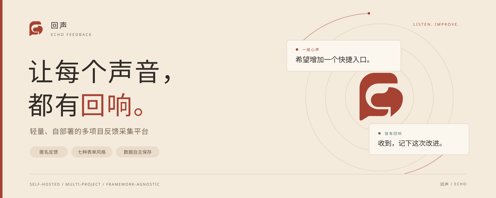
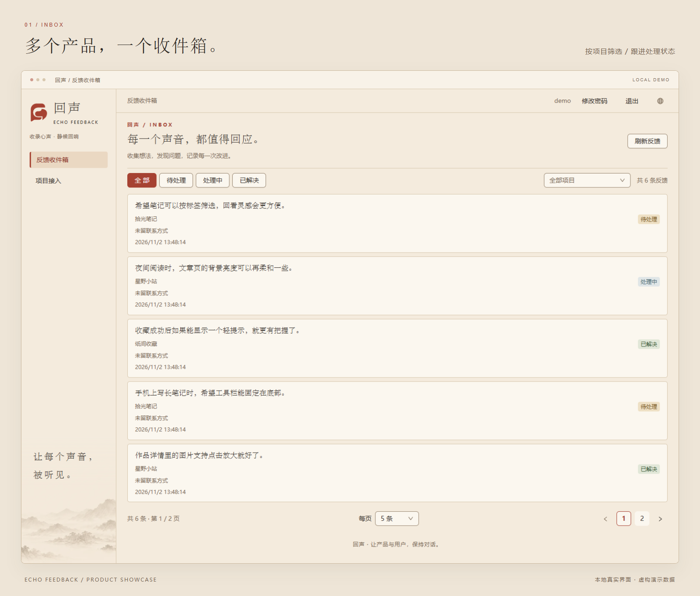
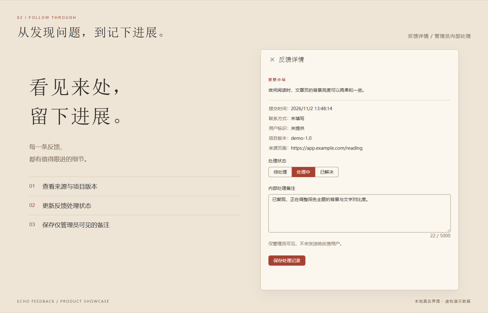
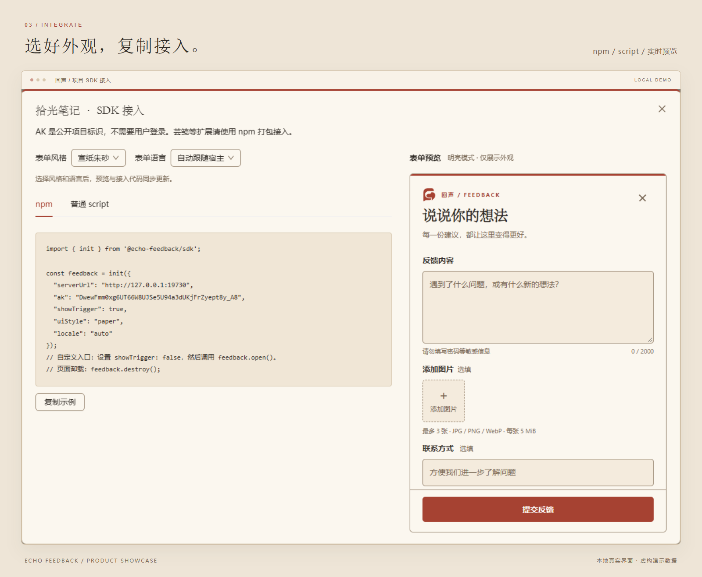
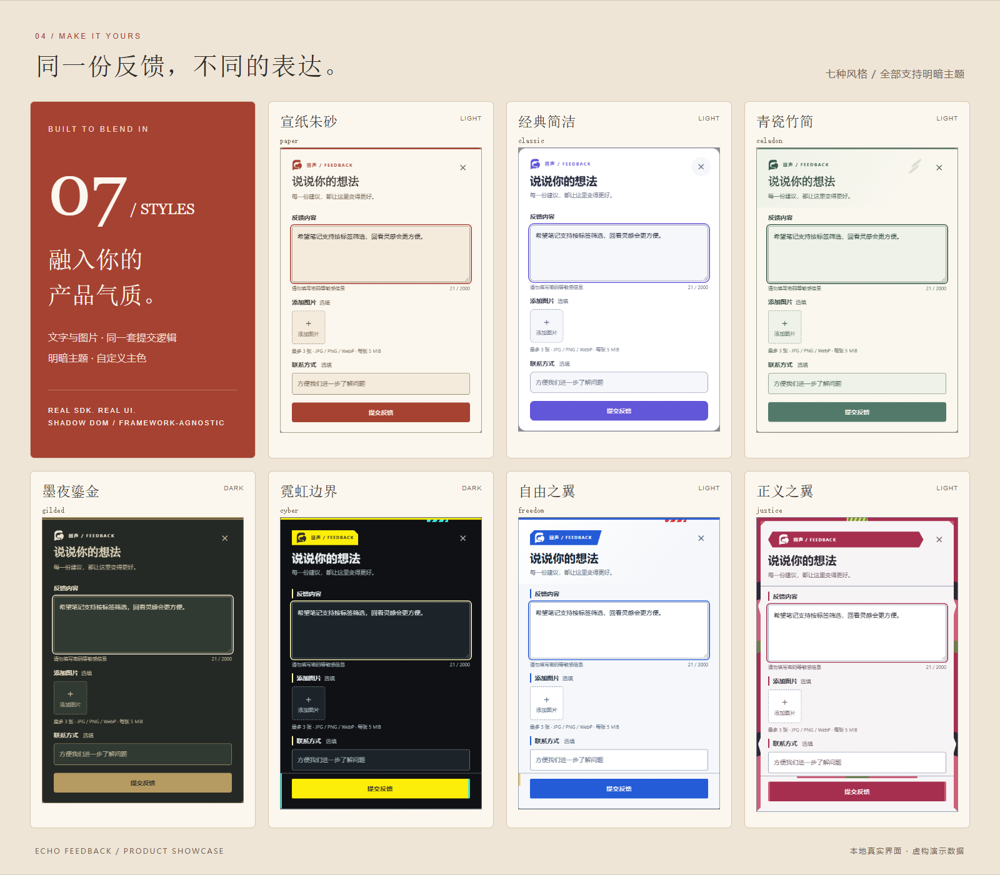
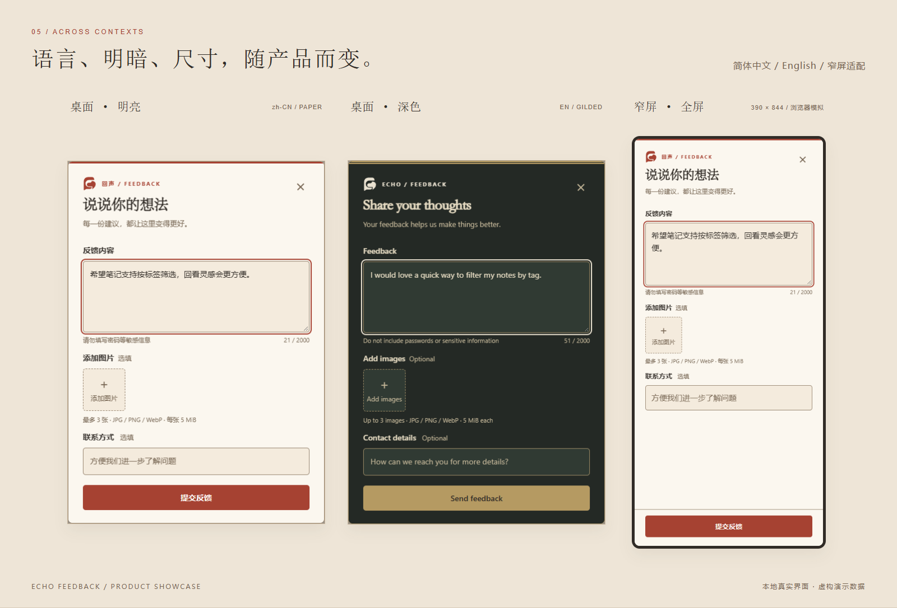
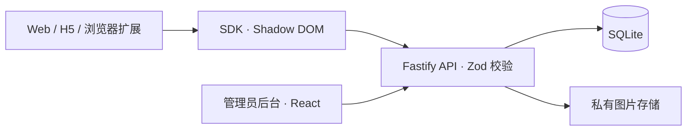

<p align="center">
  
</p>

<h1 align="center">回声 · Echo Feedback</h1>

<p align="center">
  给产品一个反馈入口，让用户的想法抵达你的收件箱。<br />
  匿名提交 · 多项目管理 · 七种表单风格 · 简体中文 / English
</p>

<p align="center">
  <a href="https://github.com/Fuego-Zero/echo-feedback/actions/workflows/ci.yml"></a>
  <a href="https://www.npmjs.com/package/@echo-feedback/sdk"></a>
  <a href="LICENSE"></a>
  
</p>

<p align="center">
  <a href="#界面预览">界面预览</a> ·
  <a href="#表单外观">表单外观</a> ·
  <a href="#快速开始">快速开始</a> ·
  <a href="#接入你的产品">SDK 接入</a> ·
  <a href="docs/deployment.md">部署指南</a> ·
  <a href="packages/sdk/README.en.md">English SDK guide</a>
</p>

---

回声是一个轻量、自部署的多项目反馈采集平台，为 Web 应用、H5 页面和浏览器扩展提供统一的反馈入口。用户填写正文即可匿名提交，图片和联系方式均为选填；管理员在独立后台查看反馈、跟进状态、记录处理过程。

一个回声服务可以连接多个产品。每个项目使用自己的公开接入标识 AK，反馈、数据库和用户主动上传的图片保存在你自己的服务中。

## 功能一览

| 能力             | 你可以做什么                                                          |
| ---------------- | --------------------------------------------------------------------- |
| **低门槛反馈**   | 无需登录回声，填写正文即可提交；支持最多 3 张图片，每张不超过 5 MiB   |
| **统一收件箱**   | 按项目、处理状态筛选，分页浏览反馈，查看来源页面与可选的项目版本信息  |
| **处理有记录**   | 在待处理、处理中、已解决之间更新状态，添加仅管理员可见的内部备注      |
| **适配产品风格** | 七种内置皮肤、明暗主题、自定义主色；桌面居中弹窗，窄屏使用全屏面板    |
| **中英文界面**   | 后台与 SDK 支持简体中文和 English；SDK 可自动匹配宿主语言或由宿主指定 |
| **框架无关接入** | 原生 TypeScript SDK，支持 npm 与普通 script，使用 Shadow DOM 封装样式 |
| **自行部署维护** | SQLite 与私有图片存储，提供 Docker Compose、健康检查和备份恢复工具    |

## 界面预览

以下均为当前项目在本地隔离环境中的真实界面截图，项目名称和反馈内容为虚构演示数据。窄屏画面来自浏览器模拟，不代表手机真机或第三方宿主验收。

### 01 / 多个产品，一个收件箱

按项目和状态找到需要关注的反馈，把问题、建议与已完成的改进放在同一处管理。



### 02 / 留下处理过程

打开详情，查看正文、来源页面和项目版本，更新处理状态并保存内部备注。备注仅管理员可见，不会自动发送给反馈用户。



### 03 / 看着效果，复制接入代码

创建项目后，在后台选择表单风格与语言，实时预览 SDK 的外观，再复制 npm 或 script 示例。预览选项用于生成接入代码，由宿主初始化配置决定实际外观。



## 表单外观

从宣纸朱砂到霓虹边界，七种风格共用同一套文字、图片、提交与重试逻辑。使用 `uiStyle` 选择风格，使用 `theme` 控制明暗，也可以通过 `primaryColor` 设置六位十六进制主色。



| 风格     | `uiStyle` | 风格     | `uiStyle` |
| -------- | --------- | -------- | --------- |
| 宣纸朱砂 | `paper`   | 经典简洁 | `classic` |
| 青瓷竹简 | `celadon` | 墨夜鎏金 | `gilded`  |
| 霓虹边界 | `cyber`   | 自由之翼 | `freedom` |
| 正义之翼 | `justice` |          |           |

**语言、主题与布局可以自由搭配。** SDK 默认自动匹配宿主页面语言，支持 `zh-CN` 和 `en`；桌面使用居中弹窗，窄屏切换为全屏表单。宿主切换语言时，可以调用 `setLocale()` 原地更新，保留已填写的内容。



## 快速开始

本地开发基准环境：**Node.js 22.21.1 · pnpm 10.28.0**。

```sh
git clone https://github.com/Fuego-Zero/echo-feedback.git
cd echo-feedback
pnpm install --frozen-lockfile
pnpm env:init
pnpm build
pnpm start
```

打开 **<http://127.0.0.1:8730>**，完成首次初始化：

1. 从本机 `.env` 读取 `SETUP_TOKEN`，在初始化页创建管理员。密码至少 12 位，包含字母和数字；没有默认账号。
2. 进入「项目接入」，创建项目，按需配置允许的网页来源或开启浏览器扩展接入。
3. 点击「接入」，选择外观与语言，复制 SDK 示例到你的产品。
4. 在宿主提交一条反馈，再回到收件箱查看与处理。

`pnpm env:init` 仅在 `.env` 不存在时生成配置与随机初始化密钥。管理员创建完成后，初始化入口关闭。

## 接入你的产品

### npm / 现代前端项目

在宿主项目中安装 SDK。SDK 不包含服务端，`serverUrl` 指向你部署的回声服务，`ak` 从后台项目接入页复制。

```sh
npm install @echo-feedback/sdk
```

在浏览器 DOM 可用后初始化；默认会显示一个悬浮反馈入口：

```ts
import { init } from "@echo-feedback/sdk";

const feedback = init({
  serverUrl: "https://feedback.example.com",
  ak: "替换为后台生成的项目 AK",
  uiStyle: "paper",
  theme: "system",
  locale: "auto",
});

// 宿主切换语言时，可同步入口与已打开的表单。
// feedback.setLocale("en");

// 页面或组件卸载时调用，释放节点、监听器和在途请求。
// feedback.destroy();
```

已有反馈按钮时，设置 `showTrigger: false`，在按钮点击时调用 `feedback.open()`。React / Next.js、Vue 3 的挂载与清理示例见 [AI 快速接入指南](docs/ai-integration.md)。

### 普通网页 / 浏览器扩展

| 接入场景           | 推荐方式                                                                                    |
| ------------------ | ------------------------------------------------------------------------------------------- |
| 普通 HTML、H5 页面 | 后台「接入 → 普通 script」复制完整代码；脚本地址以后台生成的地址为准                        |
| 浏览器扩展         | 将 SDK ESM 随扩展本地打包，在后台开启扩展接入，并声明目标服务的 `host_permissions`          |
| 全屏页面或游戏     | 将 `mountTarget` 指向现有全屏容器，使用 `onOpen` / `onClose` 协调宿主输入和关闭后的焦点恢复 |

AK 是公开项目标识，管理员通过独立账号登录。SDK 仅上传用户填写的内容、主动选择的图片及约定的来源信息，不采集宿主 Cookie、Token、日志或自动截图。来源页面会去掉 query 与 hash；用户标识属于宿主传入的未验证信息。

详细配置、CSP、语言切换与幂等重试规则见 [SDK 接入文档](docs/sdk.md) 和 [接口与安全](docs/security.md)。

## 部署与数据

提供 [Docker Compose 配置](deploy/compose.yml) 与 [Nginx 示例](deploy/nginx.conf.example)。部署时配置公开 HTTPS Origin、初始化密钥、可信代理和独立的数据目录，操作步骤见 [配置、部署和恢复](docs/deployment.md)。

| 组成         | 说明                                                              |
| ------------ | ----------------------------------------------------------------- |
| 运行方式     | 单容器启动 Web / API；数据库迁移成功后接收流量                    |
| 数据持久化   | SQLite 数据库和私有附件保存在独立数据目录，附件需管理员登录后访问 |
| 运行检查     | `/api/health/live` 检查存活，`/api/health/ready` 检查数据库与存储 |
| 备份与恢复   | 提供 `pnpm data:backup` 和完整数据目录备份、恢复说明              |
| 当前部署范围 | SQLite 单实例，不支持多副本运行                                   |

服务版本由根目录 `package.json` 管理。递增版本的 PR 合入后，CI 在镜像验收并推送成功后自动生成 `v<版本号>` GitHub Release；SDK 保持独立版本。自动发行与历史版本补录见[部署指南](docs/deployment.md#github-发行与补录)。

## 工程与验证

**TypeScript strict · pnpm workspace · React / Ant Design / Vite · Fastify / Zod · SQLite / Drizzle**



开发与完整验证：

```sh
pnpm dev

# 修改 SDK 后重建浏览器产物
pnpm --filter @echo-feedback/sdk build

# 首次执行浏览器自动化前安装 Chromium
pnpm exec playwright install chromium
pnpm verify
```

`pnpm verify` 依次执行类型检查、lint、格式检查、Vitest、构建和 Playwright。测试集中在根目录 `tests/`，临时数据库、截图与报告放在 `.tmp/`。浏览器自动化、真实宿主联调和手机真机验收分别记录；实际宿主与设备检查项见 [宿主与验收](docs/integration.md)。

<details>
<summary>仓库结构与分页约定</summary>

```text
apps/
  api/          管理会话、项目和反馈 HTTP 接口
  web/          管理后台、静态资源与流式反代
packages/
  contracts/    Zod 输入协议、字段限制与公共类型
  runtime/      配置、SQLite / Drizzle、迁移与私有存储
  sdk/          框架无关的反馈面板、图片上传与重试
tests/          单元、接口、浏览器与部署验证
docs/           接入、部署、安全与品牌文档
```

包间仅使用公开入口；浏览器使用 `contracts`，不引入服务端 `runtime`。

反馈收件箱和项目接入使用服务端分页，默认每页 20 条，可选 5、10、20、50、100 条。`GET /api/admin/feedback`、`GET /api/admin/projects` 接收 `page`、`pageSize`，返回 `{ items, total, page, pageSize }`。页码从 1 开始，每页最多 100 条；越界返回空列表与真实总数，非法参数返回 400。

反馈列表保留 `projectId`、`status` 筛选，`total` 为筛选后的总数。切换筛选或每页条数时回到第一页，末页失效时回到最后一个有效页。项目筛选使用需登录的 `GET /api/admin/projects/options`，返回全部项目的 `id`、`name`，不受管理列表当前分页影响。

</details>

## 文档导航

| 想了解什么                 | 从这里开始                                                                                            |
| -------------------------- | ----------------------------------------------------------------------------------------------------- |
| 把反馈入口接入现有产品     | [AI 快速接入指南](docs/ai-integration.md)                                                             |
| SDK 配置、风格、语言与重试 | [SDK 接入](docs/sdk.md) · [中文包说明](packages/sdk/README.md) · [English](packages/sdk/README.en.md) |
| 配置服务、升级、备份与恢复 | [配置与部署](docs/deployment.md)                                                                      |
| 认证、来源限制与数据边界   | [接口与安全](docs/security.md)                                                                        |
| 宿主适配与人工验收清单     | [宿主与验收](docs/integration.md)                                                                     |
| 贡献界面或维护 SDK 发布    | [UI 组件约定](docs/ui-components.md) · [npm 发布流程](docs/npm-release.md)                            |
| 品牌与 README 配图维护     | [品牌规范](docs/brand-guide.md) · [配图说明](docs/readme-visuals.md)                                  |

---

<p align="center">
  <strong>一纸心声，皆有回响。</strong><br />
  <sub>回声 · 让产品与用户，保持对话。 · <a href="LICENSE">MIT License</a></sub>
</p>
